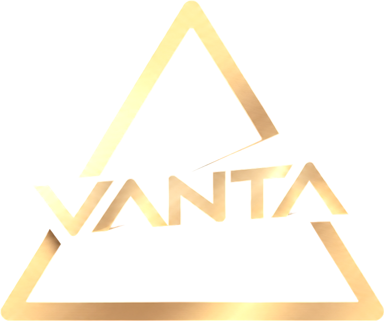

<div align="center">

  **🌐 Languages / Idiomas / Linguagens:**  
  [🇧🇷 Português (Brasil)](README.md) &nbsp;•&nbsp; [🇺🇸 English](README.en.md) &nbsp;•&nbsp; [🇪🇸 Español](README.es.md)

  <br/><br/>

  

  # 🌌 VANTA SITE
  ### Official Web Portal & Security Dashboard • Vantinha

  <p align="center">
    The official web portal for the <strong>Vanta</strong> ecosystem and the <strong>Vantinha</strong> assistant (<a href="https://discord.com"><code>Vantinha#0419</code></a>).<br/>
    High-performance engineering, minimalist aesthetic, and direct integration with the community security cluster.
  </p>

  <p align="center">
    
    
    
    
    
    
  </p>

</div>

---

## 🏛️ Architecture Overview

The **Vanta Site** serves as the primary web interface for the **Vanta Hub** community, engineered under the **Master Data Gateway** principle:

```
                       ┌────────────────────────────────────────┐
                       │           BROWSER / CLIENT             │
                       │    (Landing Page, Dashboard & Verify)  │
                       └───────────────────┬────────────────────┘
                                           │
                         Encrypted Tunnel  │ AES-256-GCM + API Key
                                           ▼
                       ┌────────────────────────────────────────┐
                       │        BOT MASTER DATA GATEWAY         │
                       │           (Fastify API Gateway)        │
                       └───────────┬────────────────┬───────────┘
                                   │                │
                    Direct Storage │                │ Native WebSocket
                    Synchronization│                │ Components V2
                                   ▼                ▼
                       ┌────────────────┐    ┌──────────────────┐
                       │ Cloud Database │    │ Discord Gateway  │
                       │ (Firestore)    │    │ (Roles, Channels)│
                       └────────────────┘    └──────────────────┘
```

> 🛡️ **Confidentiality & Integrity Principle**: The website never communicates with the database directly. The Discord bot acts as the Single Source of Truth, handling 100% of security verifications, alternate account detection, network audits, and automated role assignments.

---

## ⚡ Technologies & Ecosystem

### Frontend & Web Dashboard
* **Framework:** [Next.js 14](https://nextjs.org/) (App Router with hybrid static and dynamic rendering).
* **Language:** TypeScript with strict type contracts.
* **Styling:** [Tailwind CSS](https://tailwindcss.com/) grounded in Vanta's official design tokens.
* **Typography:** `Space Grotesk` (architectural headers) and `Plus Jakarta Sans` (refined readability).

### Backend & Cluster Services
* **Bot Framework:** `Constatic Framework` in pure ESM.
* **API Gateway:** `Fastify` with CORS enabled and `x-api-key` header verification.
* **Discord Integration:** Native `Discord Components V2` containers, dynamic sections, and responsive UI elements.
* **Cryptographic Tunnel:** Authenticated `AES-256-GCM` cipher with 12-byte IV, 16-byte authentication tags, and SHA-256 key derivation.
* **Cloud Persistence:** Google Cloud Firestore cluster instance.

---

## 🛡️ Core Security Capabilities

```
 ┌────────────────────────────────────────────────────────────────────────┐
 │ 1. GLOBAL ALT DETECTION (DUPLICATE ACCOUNTS)                           │
 │    Cross-references IP history and authentication fingerprints to      │
 │    detect duplicate profiles, mitigate raids, and stop punishment      │
 │    evasion across the community.                                       │
 ├────────────────────────────────────────────────────────────────────────┤
 │ 2. ACTIVE NETWORK AUDIT & PROXY/VPN SHIELD                             │
 │    Verifies network integrity and blocks suspicious proxy/VPN origins  │
 │    before granting member privileges on Discord.                       │
 ├────────────────────────────────────────────────────────────────────────┤
 │ 3. ONE-TIME SECURE VERIFICATION PORTAL                                 │
 │    Ephemeral 15-minute verification tokens generated directly via chat,│
 │    with immediate token burning upon authorization.                    │
 ├────────────────────────────────────────────────────────────────────────┤
 │ 4. NATIVE INTERACTIVE COMMANDS                                         │
 │    /help: Comprehensive command guide, community status, and support   │
 │    /ping: Real-time Discord WebSocket gateway latency & bot response   │
 │    /counter: Reactive stateful components with zero chat flicker       │
 └────────────────────────────────────────────────────────────────────────┘
```

---

## 🎨 Official Color Palette (Design Tokens)

The Vanta visual design adopts an austere, noble Vantablack and Gold aesthetic:

| Token | Hex Value | Application |
| :--- | :--- | :--- |
| `vantaGold` | `#E5A93C` | **Official Vanta Gold** (Brand identity, primary CTA, badges, highlights) |
| `vanta` | `#0a0a0c` | Main background (*Vantablack* aesthetic) |
| `vantaDark` | `#121217` | Card surfaces, modals, containers, and sidebars |
| `vantaLight` | `#1c1c24` | Subtle borders, dividers, and secondary interactive layers |
| `success` | `#22c55e` | Verified status indicators and successful handshake tags |
| `danger` | `#ED4245` | Security warnings, bans, and malicious IP rejections |

---

## 🌐 Official Ecosystem & Access

Vantinha is a proprietary, closed ecosystem operated exclusively for the **Vanta Community**:

* **Add the Bot**: [Invite Vantinha to your Discord Server](https://discord.com/oauth2/authorize?client_id=1567751920645308548&response_type=code&redirect_uri=localhost%3A3000&scope=identify+guilds+guilds.join)
* **Official Community**: [Join Vanta Hub on Discord](https://discord.gg/vanta)
* **Web Dashboard**: Secure Discord OAuth2 authentication for authorized community members.

---

## 🔒 Governance & Continuous Ledger

This repository strictly abides by the **Vanta Ledger Protocol**, recording every update, architectural decision, and design checkpoint in [PROJECT_STATE.md](./PROJECT_STATE.md).

---

## ⚖️ License & Anti-Plagiarism Policy

This software is protected under the **Proprietary Source Code License (All Rights Reserved)**.

> 🛑 **STRICT PROHIBITION OF PLAGIARISM AND UNAUTHORIZED USE**:  
> Cloning, copying, redistributing, republishing, reselling, or misappropriating any portion of this source code, brand identity, visual assets, or interface components across competing platforms, bots, or third-party services is strictly prohibited.  
> All intellectual property rights are reserved by **Vanta Community** and **Vítor Dev** ([vitordevmm](https://github.com/vitordevmm)). Violations will be met with immediate legal action and DMCA Takedown enforcement.

For complete terms and conditions, refer to the [LICENSE](./LICENSE) file.

---

<div align="center">
  <p><strong>Vanta Community</strong> • <em>Gold & Vantablack</em></p>
  <p>© 2026 Vanta Hub. All rights reserved.</p>
</div>
